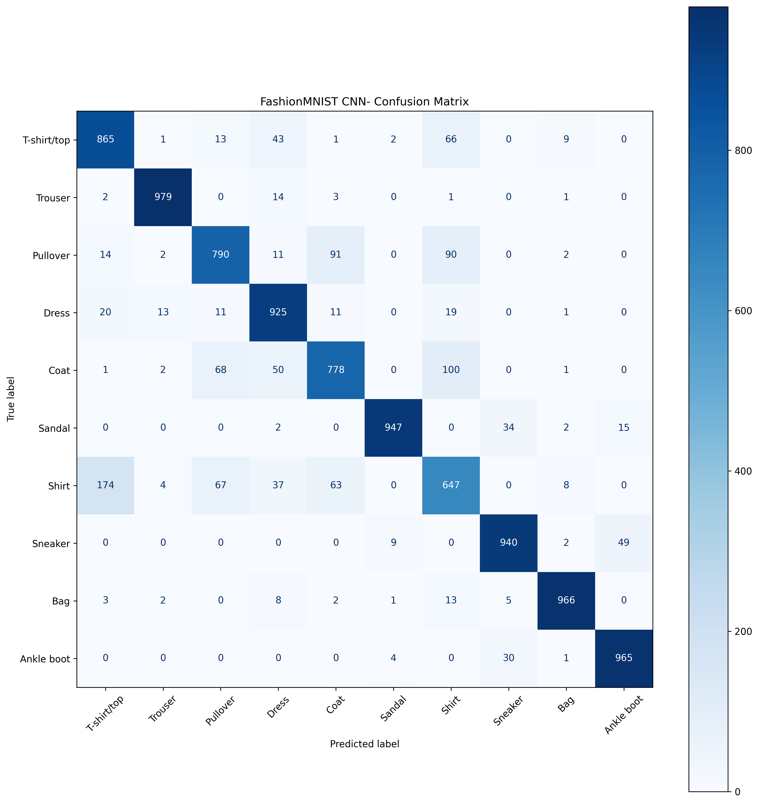
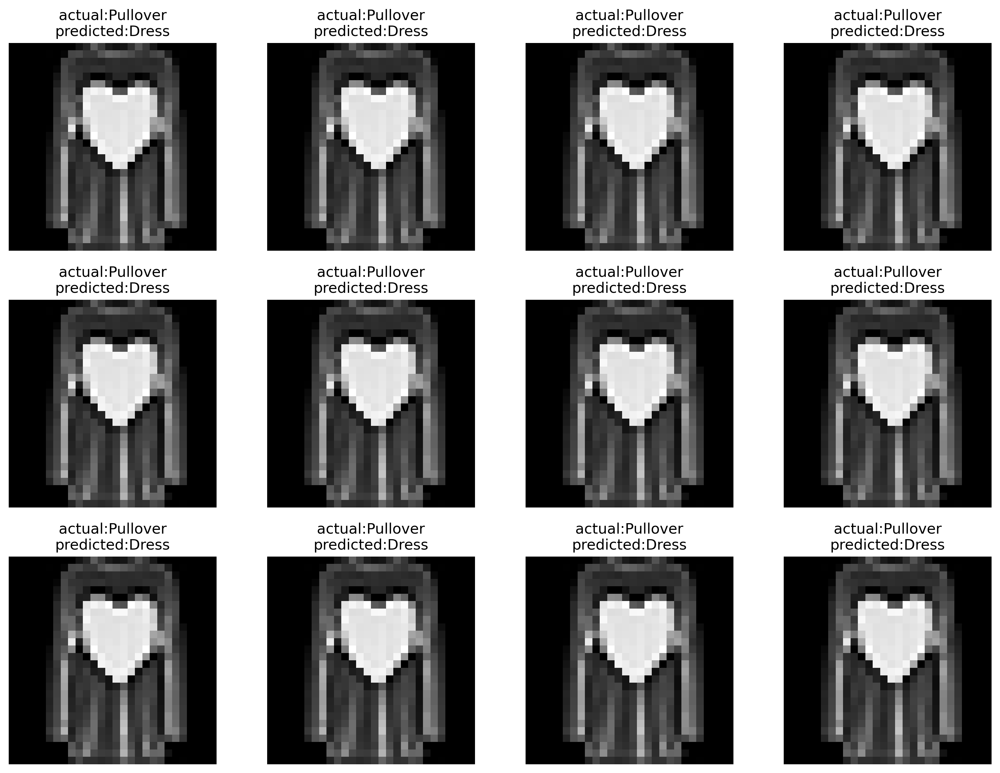

# FashionMNIST Clothing Classification Using CNN

## Project Overview

This project implements a Convolutional Neural Network (CNN) using PyTorch to classify clothing images from the FashionMNIST dataset into 10 categories. The model learns visual features from grayscale images and predicts the corresponding clothing category.

The project demonstrates the practical application of deep learning in image classification, including model development, training, evaluation, and error analysis.

## Objectives

- Build a CNN using PyTorch.
- Train the model on the FashionMNIST training dataset.
- Evaluate classification performance on unseen test images.
- Analyze predictions using a confusion matrix.
- Examine correctly and incorrectly classified images.

## Dataset

**Dataset:** FashionMNIST  
**Source:** [FashionMNIST — Zalando Research](https://github.com/zalandoresearch/fashion-mnist)

FashionMNIST contains 70,000 grayscale images of clothing items.

| Dataset | Number of images |
|---|---:|
| Training set | 60,000 |
| Test set | 10,000 |
| Total | 70,000 |

Each image has a resolution of 28 × 28 pixels and belongs to one of 10 clothing categories:

1. T-shirt/top
2. Trouser
3. Pullover
4. Dress
5. Coat
6. Sandal
7. Shirt
8. Sneaker
9. Bag
10. Ankle boot

## Technologies Used

- Python
- PyTorch
- Torchvision
- NumPy
- Matplotlib
- Scikit-learn
- Google Colab

## Model Architecture

The CNN consists of two convolutional blocks followed by a fully connected classifier.

| Layer | Configuration |
|---|---|
| Input | 1 × 28 × 28 grayscale image |
| Convolution 1 | 1 input channel, 16 output channels, 3 × 3 kernel |
| Activation | ReLU |
| Max Pooling 1 | 2 × 2 |
| Convolution 2 | 16 input channels, 32 output channels, 3 × 3 kernel |
| Activation | ReLU |
| Max Pooling 2 | 2 × 2 |
| Flatten | 1,568 features |
| Fully connected layer | 128 neurons |
| Output layer | 10 class scores |

**Training configuration**

- Loss function: Cross-Entropy Loss
- Optimizer: Adam
- Learning rate: 0.001
- Execution device: CPU

## Model Performance

The model achieved the following test accuracy during experimentation:

| Metric | Result |
|---|---:|
| Test images | 10,000 |
| Correct predictions | 8,802 |
| Incorrect predictions | 1,198 |
| Test accuracy | 88.02% |

Accuracy is calculated as the number of correct predictions divided by the total number of test images.

**Note:** The reported accuracy is from the latest evaluation during experimentation. A final reproducible evaluation should be performed after the model and evaluation procedure are fixed.

## Visual Results

### Confusion Matrix

The confusion matrix compares the actual clothing categories with the categories predicted by the CNN. It helps identify which classes are classified correctly and which are frequently confused.



### Actual vs. Predicted Images

This visualization compares the ground-truth labels with the model's predictions. Green titles indicate correct predictions, while red titles indicate incorrect predictions.



## Error Analysis

The classification report showed differences in performance across clothing categories.

- **Trouser:** F1-score of 0.979.
- **Bag:** F1-score of 0.956.
- **Sneaker:** F1-score of 0.928.
- **Shirt:** F1-score of 0.614.

Shirts were among the most challenging categories for the model, suggesting that visually similar clothing items can be difficult to distinguish at the dataset's low image resolution.

The confusion matrix and misclassified image examples provide additional insight into these errors.

## Project Structure

```text
fashionmnist-cnn/
├── README.md
├── notebook.ipynb
├── fashion_cnn.pth
└── images/
    ├── confusion_matrix.png
    └── actual_vs_predicted.png
```

- `README.md`: Project documentation.
- `notebook.ipynb`: Model implementation, training, and evaluation.
- `fashion_cnn.pth`: Saved PyTorch model weights.
- `images/`: Saved evaluation visualizations.

## How to Run the Project

### 1. Clone the repository

```bash
git clone https://github.com/mirukyilikal/fashionmnist-cnn
cd fashionmnist-cnn
```


### 2. Install dependencies

```bash
pip install torch torchvision numpy matplotlib scikit-learn
```

### 3. Run the notebook

Open `notebook.ipynb` in Google Colab or Jupyter Notebook and execute the cells in order.

The notebook downloads FashionMNIST, defines the CNN, trains the model, and evaluates its predictions.

### 4. Load the saved model

After defining the same `FashionCNN` architecture, load the saved weights with:

```python
import torch

model = FashionCNN()

model.load_state_dict(
    torch.load("fashion_cnn.pth", map_location="cpu")
)

model.eval()
```

## Future Improvements

- Add a validation set for model selection and hyperparameter tuning.
- Evaluate precision, recall, and F1-score after final training.
- Experiment with different CNN architectures and training configurations.
- Build an interactive image prediction application using Streamlit.
- Compare the CNN with a simple fully connected neural network baseline.

## Conclusion

This project demonstrates an end-to-end deep learning workflow for clothing image classification using PyTorch. It covers CNN architecture design, model training, test evaluation, and error analysis through visualizations and classification metrics.

The results illustrate how convolutional neural networks can learn visual features for image classification while also highlighting the challenges of distinguishing visually similar categories.
